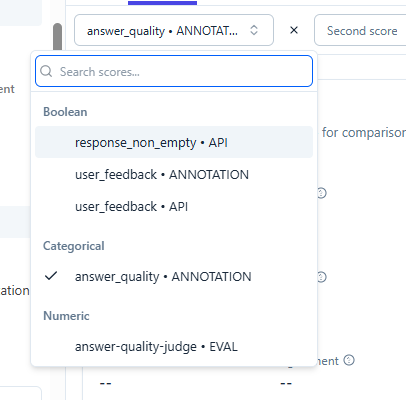
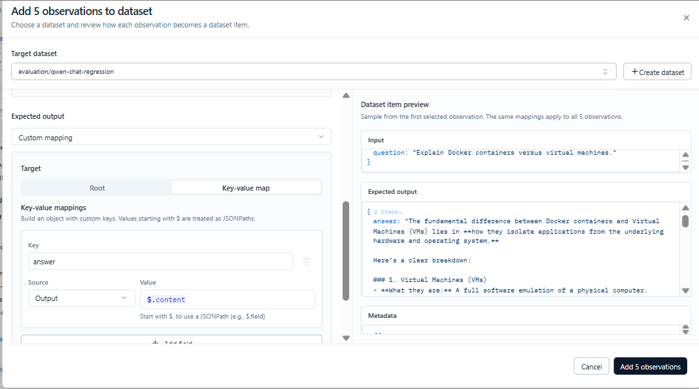

This directory is to show the use of langfuse in an application, consider this as the root directory of buidling your applciations

--------


## Trace 

Trace is basically the complete execution of one logical request/workflow. ie 

Trace = one complete logical execution.

Observation = one measurable operation/step inside that execution.

```
TRACE
"What is our refund policy?"
│
├── Observation: input validation
│
├── Observation: query rewriting
│
├── Observation: retrieve documents
│
├── Generation: LLM call for answer
│
├── Observation: output validation
│
└── Observation: final response
```

eg2:
```
TRACE
request_id=abc123
│
├── OBSERVATION
│   input_guardrail
│
├── OBSERVATION
│   retrieve_documents
│
├── GENERATION
│   gpt-5.6
│
├── OBSERVATION
│   search_database
│
├── GENERATION
│   final_answer
│
└── OBSERVATION
    output_guardrail
```

| Concept         | Meaning                                                    |
| --------------- | ---------------------------------------------------------- |
| **Trace**       | Complete logical execution/request                         |
| **Observation** | A step/operation within the trace                          |
| **Generation**  | Observation representing an LLM/model call                 |
| **Span**        | Observation representing a general operation/workflow step |

and the observation ca be 

```
Trace
 └── Observations
       ├── Span
       ├── Generation
       ├── Event
       ├── Retriever
       ├── Agent
       └── Tool
```
Generation types from documentation:


 * event is the basic building block. An event is used to track discrete events in a trace.
 * span is the generic observation type for durations of units of work in a trace.
 * generation logs generations of AI models incl. prompts, token usage and costs.
 * agent decides on the application flow and can for example use tools with the guidance of a LLM.
 * tool represents a single action that does something, such as a function or API call (for example a weather API).
 * chain is a link between different application steps, like passing context from a retriever to a LLM call.
 * retriever represents a data-retrieval step that only looks something up rather than changing state, such as a call to a vector store, database, or other knowledge source.
 * evaluator represents functions that assess relevance/correctness/helpfulness of a LLM's outputs.
 * embedding is a call to a LLM to generate embeddings and can include model, token usage and costs
 * guardrail is a component that protects against malicious content or jailbreaks.


Custom prices needs to be defined if langfuse does not have the info of the price of model you are using, by going to Project Settings → Model Definitions


## Sessions

Langfuse recommends sessions for multi-turn conversations; each turn can be its own trace while the session groups them together.

Trace = one request/turn

Session = group of related requests/traces

```
Trace: One independent request.

Observation: An individual operation within a trace.

Session: Multiple related traces sharing a session ID.

User ID: Identifies the user across sessions.
```


## Prompt Management
from the local hosted : 3000 ui
prompt management -> prompts -> create

you can create multiple prompts in the lanfuse ui , test it in the plaground then use it in code 

multiple versions will be creted , but the version with label production will be imported in code

now we can trace generations linked to a particular prompt in observability

The default cache TTL is 60 seconds, we can chnage it in the code if wanted 

## Score

A score is a quality judgment attached to a trace, observation, or session.

The four score types


| Type          | Example                                     | When to use it                              |
| ------------- | ------------------------------------------- | ------------------------------------------- |
| `NUMERIC`     | `0.9`                                       | A relevance or quality rating               |
| `CATEGORICAL` | `"correct"`                                 | A classification from predefined categories |
| `BOOLEAN`     | `1` or `0`                                  | Pass/fail checks                            |
| `TEXT`        | `"The answer omitted an important detail."` | Qualitative reviewer notes                  |


Manual Scoring Interface :

in Observabilility --> tracing -> any observation--> Annotation --> Add Score

but first Score Config is required

Add Score --> Add Score Config

then eg:


| Field       | Value                                                       |
| ----------- | ----------------------------------------------------------- |
| Name        | `answer_quality`                                            |
| Data type   | `CATEGORICAL`                                               |
| Categories  | `good`, `partially_correct`, `incorrect`                    |
| Description | `Human assessment of the overall quality of an AI response` |


you can also later go to Score settings and change the settings if needed

You should be able to select answer_quality and assign one of the three categories for each observation

User Feedback:

| Field       | Value                                                     |
| ----------- | --------------------------------------------------------- |
| Name        | `user_feedback`                                           |
| Data type   | `BOOLEAN`                                                 |
| Description | `End-user feedback on whether an AI response was helpful` |

after the 12_user_feedback_test.py code is run, the score is stored in lanfuse, you can go and check in the tracing.

Annotation Queue:

Annotation Queues are designed for structured human review: reviewers work through a collection of traces, apply consistent score configurations, and record judgments. Those human judgments can later help validate the LLM judge

Instead of opening traces individually, you'll place several traces into a queue and review them one by one using consistent scoring criteria.

Observability --> tracing --> open any observation --> Add to --> Annotation queue --> Create New Queue

```
Queue name
qwen-answer-review

Description
Review Qwen responses for correctness and helpfulness.
Score configurations
- answer_quality
- user_feedback 

```
  The queue requires at least one score configuration. We'll use answer_quality as the primary human-review label.

Open Tracing --> Select two or three of your existing traces

then Evaluation --> Human Annotation --> Process queue

Open the new queue and start processing its items.

LLM-as-a-Judge:

Evaluation --> Evaluators --> New evaluator

Section 1 (Define evaluation)

Choose LLM-as-a-Judge (not Code Evaluator or Decision Model).

Select model --> choose any added model


A rubric is a set of explicit criteria that tells the judge LLM how to evaluate an answer. Think of it as the marking scheme you'd give a human examiner.

by default you will see something like 

```
Evaluate the quality of the response.

Input: {{input}}
Response: {{output}}
```

Replace the evaluator instructions with the below rubic

```
Evaluate the AI response against the user's question.

Assess these criteria:
1. **Correctness:** Is the response factually correct?
2. **Relevance:** Does it directly answer the question?
3. **Completeness:** Does it address the important parts of the question?

Scoring:
- 1.0: Correct, relevant, and sufficiently complete.
- 0.5: Partially correct or relevant, but has a meaningful omission or minor error.
- 0.0: Incorrect, irrelevant, or fundamentally misleading.

Do not reward confident wording if the answer is incorrect.
Do not penalize a concise answer if it adequately answers the question.
Base your judgment only on the supplied question and response. Do not invent missing context.

User question: {{input}}
AI response: {{output}}

Return only the numeric score.
```

there is a preview toggle button on the top right of this box, there the selected observation's input and output will be substituted in place of {{input}} and {{output}}

Keep the score output numeric

Return a: number

With values: between 0 and 1

Section 2 (Map variables to data)

keep default , ie input to input , output to output

Section 3 (Name Evaluator)

Name: answer-quality-judge (its also used as the score name)

Description: Evaluates AI responses for correctness, relevance, and completeness on a 0–1 scale.)

Then select a sample generation in the right-hand panel and test the evaluator.

Inspect the score and its reasoning before creating it

--> Create Evaluator

Connect the judge to live observations:

Evaluation --> Evaluators --> answer-quality-judge (ie click newly created Evaluator )

Top right , you will see --> Rules 


Click Rules --> Attach to rule --> create new rule

here basically you are selecting which incoming observations should trigger evaluators.

Section 1 (Configure Rule Scope)

* In Filter observations, click Generations.
* Sampling rate controls what percentage of matching incoming observations gets sent to the evaluator.


Section 2 (Attach Evaluators)
* Scroll down to Attach Evaluators and confirm that answer-quality-judge is attached.


Section 3 (Name rule)
* qwen-generation-quality-monitor

--> Save and activate

now you can run  the 8_prompt_with_llm.py , this observation will be automatically scored by the Evaluator we created

you basically see this as a score (	answer-quality-judge), you can see the reasoning of the LLM judge in

Evaluation --> score 

on the same page top right , click on columns , and check the Execution trace , 

once you click on the execution trace , you will see the input and output of the LLM judge and its reasoning 


Code Evaluator:

Evaluation → Evaluators → New evaluator.

Select Code Evaluator

Select python 

replace the template with 

```

def evaluate(ctx: EvaluationContext) -> EvaluationResult:
    output = ctx.observation.output

    # Extract text from common chat-generation output shapes.
    if isinstance(output, dict):
        output = output.get("content", "")

    if isinstance(output, list):
        parts = []
        for item in output:
            if isinstance(item, dict):
                parts.append(str(item.get("content", "")))
            else:
                parts.append(str(item))
        output = " ".join(parts)

    has_content = output is not None and bool(str(output).strip())

    return EvaluationResult(
        scores=[
            Score(
                name="response_non_empty",
                value=has_content,
                data_type="BOOLEAN",
                comment=(
                    "Response contains content."
                    if has_content
                    else "Response is missing or empty."
                ),
            )
        ]
    )

```

Note: The official documentation confirms that code evaluators require a dispatcher on self-hosted Langfuse. Python specifically requires the aws-lambda dispatcher; insecure-local supports TypeScript/JavaScript only

So if you are running self hosted version, and prerequisites are installed, you can proceed with testing and creating the evaluator

If not, you can create a python evaluator in the app, which works with both Cloud / self hosted, ie Scores via API/SDK

This approach is portable across Langfuse Cloud and self-hosted deployments, including Kubernetes, because the evaluation runs in your application rather than in Langfuse's evaluator execution infrastructure. (implimented in 13_code_evaluator_test.py )

So now we have seen boolean, categorical, and Numeric Scores

Scores --> Analytics

we can see here different scores, and we can see individual analystics of that score, or, compare different scores, but, within the same category




Creating the categorical judge for comparision:
1. Go to Evaluation → Evaluators → New evaluator.
2. Select New LLM-as-a-judge.
3. Use these settings:
- Name: answer-quality-judge-categorical
- Description: Categorically evaluates response quality using the same labels as human reviewers.
- Model: Use the same Groq/Qwen model as your existing judge.
- Score output type: Select Categorical, not Numeric.
4. Define exactly these three allowed categories:
- good
- partially_correct
- incorrect

Rubic
```
Evaluate the quality of the AI response against the user's question.

**Input:** {{input}}  
**Response:** {{output}}

Assess these criteria:

1. **Correctness:** Is the response factually correct?
2. **Relevance:** Does it directly answer the user's question?
3. **Completeness:** Does it address the important parts of the question?

**Categories:**

- `good`: The response is correct, relevant, and sufficiently complete.
- `partially_correct`: The response is partially correct or relevant, but has a meaningful omission or minor error.
- `incorrect`: The response is incorrect, irrelevant, or fundamentally misleading.

Do not reward confident wording if the answer is incorrect.  
Do not penalize a concise answer if it adequately answers the question.  
Base your judgment only on the supplied question and response. Do not invent missing context.

**User question:** {{input}}  
**AI response:** {{output}}

Return exactly one category: `good`, `partially_correct`, or `incorrect`.
```

now select any generation observation and test the llm judge, and then create the Evaluator


and then as done previously, you need to attach the rule for the evaluator, attached the same rule qwen-generation-quality-monitor

now we can select the human annotated score vs the llm judge and you can show how closely your LLM judge agrees with human reviewers.


## Datasets

Datasets in Langfuse are collections of inputs (and expected outputs) for your LLM application. You can run Experiments against these datasets to test new releases before deployment to production.

Open Evaluation → Datasets.

Click + New dataset

Enter the dataset name and description 
```
Dataset name:
evaluation/qwen-chat-regression

Description:
Regression test cases for the Qwen chat application, including normal requests, edge cases, incorrect responses, and production failures.
```

Now click Create dataset

you see 3 options:

1. Add manually — understand the dataset item structure.
2. Upload CSV — bulk-import the test cases.
3. Add via Code — integrate dataset creation with your Python workflow.

For now, click Add Manually to learn the item structure with one example before we bulk-import the remaining cases.

```
{
  "question": "Explain Python decorators using a simple example."
}
{
  "answer": "A decorator is a function that takes another function, adds behavior, and returns a function. For example, a decorator can log before and after a function call without changing the original function's code."
}
```

--> Add to Dataset

--> Upload CSV 

select the file langfuse_qwen_regression_cases.csv, this has questions and aswers and metadata

Map (Drag and drop) the columns as follows:

```
input	Input
expected_output	Expected output
category	Metadata
difficulty	Metadata
```

--> Import

youll see all the datasets added.


To add a real production trace to a dataset:

Open Tracing in Langfuse.

Filter by traceTags:phase3-evaluator-calibration type:GENERATION 

Open a trace and select its ChatGroq generation.

Click + Add to dataset.

Select evaluation/qwen-chat-regression.


but since we are maintaining a mapping of 
```
{
  "question": "Explain Pytho.......
}
{
  "answer": "A decorator is.......
}
```

deleting the one added trace

tracing --> after filter is applied, select multiple generations with proper answers (considering answers are reviewed and corrected for now)

--> Add to Dataset


select the newly created dataset as target dataset


Section 1 (Map the input to an `question` object)

input = custom maping 

Select Key-value map.

Set the key to `question`

Set the source to `Input`

Set the JSONPath value to `$[1].content` only if the preview confirms that index 1 is the user message for the selected observations.


Section 2 (Map the expected output to an `answer` object)

Change it to Custom mapping

Select Key-value map.

Key: answer

Source: Output

Value: `$.content` (since there are no indexes here)



--> Add 5 observations

